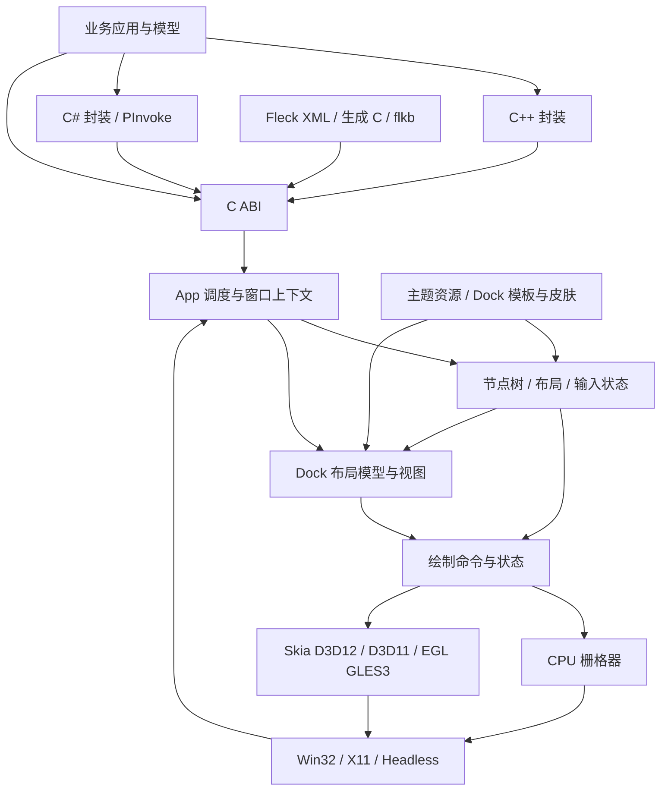
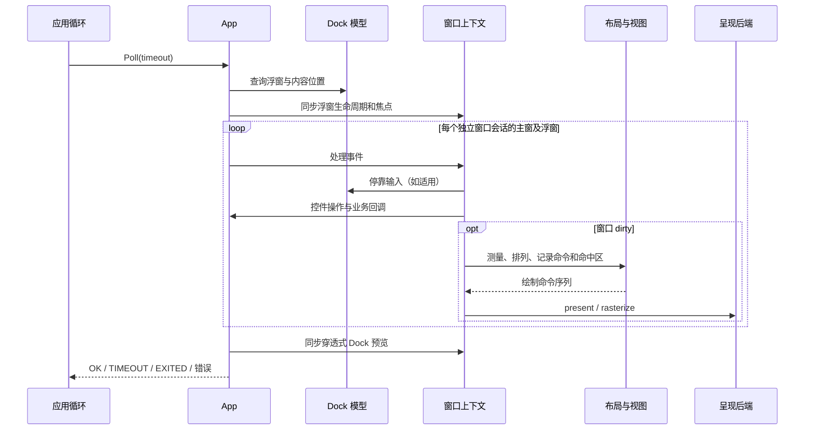
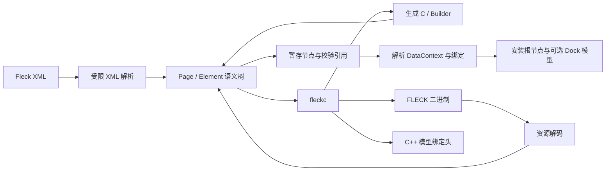

# Sunfleck 技术架构

本文说明组件如何协作及其约束；具体参数和示例分别由 [构建](building.md)、[Fleck](../../docs/guides/fleck.md)、[Dock](../../docs/guides/docking.md)、[主题](../../docs/guides/themes.md)、[C#](../../docs/guides/csharp.md)、[开发工具](../../docs/guides/devtools.md) 和 [渲染部署](../../docs/guides/rendering.md) 维护。

## 1. 架构概览

Sunfleck 采用保留式 UI 树：应用创建节点、文本源和命令，框架保留状态，在输入或属性变化后重新布局并生成绘制命令。C ABI 是各语言共享入口，C++ 提供 RAII 封装，C# 通过 P/Invoke 调用同一原生核心，Fleck 最终也安装为同一种节点与 Dock 模型。

图中表示职责和数据流，尚不对应多个独立库。当前核心主要构建为一个静态库；平台适配、事件分发与应用管理仍集中在 app.cpp，布局与控件绘制集中在 ui_tree.cpp。新增功能应沿已有接口边界扩展，避免把图中的逻辑分层误认为已完成物理拆分。

## 2. 模块与源码定位

| 模块 | 职责 | 主要源码 |
|---|---|---|
| 公共接口 | 不透明句柄、状态码、版本化描述、C++ 包装 | [ui.h](../include/sunfleck/ui.h)、[ui.hpp](../include/sunfleck/ui.hpp)、[dock.hpp](../include/sunfleck/dock.hpp) |
| 应用与平台 | 所有权、窗口调度、输入、焦点、IME、剪贴板、呈现与回退 | [app.cpp](../src/app.cpp) |
| 节点与布局 | 节点状态、容器测量与排列、控件绘制、弹层几何 | [ui_tree.h](../src/ui_tree.h)、[ui_tree.cpp](../src/ui_tree.cpp)、[layout.h](../src/layout.h) |
| 主题与材质 | 内置调色板、形状、覆盖、抗锯齿圆角及窗口内玻璃材质 | [theme.h](../src/theme.h)、[theme.cpp](../src/theme.cpp)、[material.cpp](../src/material.cpp) |
| 文本 | 测量、字形栅格化、编辑光标位置、旋转文本 | [gallery.cpp](../src/gallery.cpp)、[gallery.h](../src/gallery.h)、[freetype_text.cpp](../src/freetype_text.cpp) |
| 绘制后端 | 绘制命令、CPU 合成、GPU 表面 | [drawing_commands.h](../src/drawing_commands.h)、[skia_d3d12_surface.cpp](../src/skia_d3d12_surface.cpp)、 [raster.h](../src/raster.h)、[raster.cpp](../src/raster.cpp)、[gpu_surface.h](../src/gpu_surface.h)、[d3d11_surface.cpp](../src/d3d11_surface.cpp)、[gles_surface.cpp](../src/gles_surface.cpp) |
| 属性绑定 | 类型化模型、属性元数据、批量通知、TwoWay、UI 投递 | [binding.h](../src/binding.h)、[binding.cpp](../src/binding.cpp)、[property_model.hpp](../include/sunfleck/property_model.hpp) |
| Fleck | 语义树、XML 子集解析、编译资源读写、安装 | [fleck.h](../src/fleck.h)、[fleck.cpp](../src/fleck.cpp)、[compiled_fleck.cpp](../src/compiled_fleck.cpp)；安装逻辑在 app.cpp |
| Dock | 布局事务、持久化、拖拽、装饰与命中 | [dock.h](../src/dock.h)、[dock.cpp](../src/dock.cpp)、[dock_view.cpp](../src/dock_view.cpp)、[dock_json.h](../src/dock_json.h) |
| 托管绑定 | P/Invoke、委托保活、异常桥接、生命周期检查 | [bindings/csharp](../bindings/csharp) |
| 工具 | 页面与主题编译、XML 预览、模型元数据、共享语言服务与检查器 | [fleckc.cpp](../tools/fleckc.cpp)、[fleck_preview.c](../tools/fleck_preview.c)、[tools/development](../tools/development)、[devtools.cpp](../src/devtools.cpp) |

gallery.cpp 仍承担通用文本功能，名称不只表示展厅。平台代码与布局绘制的进一步拆分属于后续重构，当前不存在独立的 ui_platform、ui_layout 或 ui_render CMake 库。

## 3. 运行时对象与所有权

### App 与窗口上下文

ui_app 拥有业务节点、模型、文本源、命令、独立窗口会话、主题及皮肤注册表。默认主窗口和每个新增 ui_window 分别拥有活动/停用 Fleck 页面、Dock 工作区、浮窗集合、刷新队列、刷新报告与状态钩子。每个会话可使用相同的 Fleck ID 和 Dock 项目 ID；节点不能跨会话挂接。模型、文本源和命令可以显式共享，主题及皮肤仍为 App 级配置。

每个 ui_window_context 保存一个原生或 Headless 窗口的尺寸、DPI、根节点引用、焦点、悬停、捕获相关状态、输入法、GPU 表面和软件像素缓冲。ui_app 继承当前会话及窗口上下文；SessionScope 先选择所属会话，WindowScope 再选择会话内的主窗口或浮窗，离开作用域后依次恢复。原生回调引用稳定地址的上下文，该机制复用同一输入、编辑与呈现代码。

ui_window_invoke / C++ Window.withContext / C# Window.WithContext 在同步回调期间为现有 App API 选择目标会话。原生输入、Dock 事件及刷新钩子自动选择所属会话。回调不可重入 Poll/Run、销毁 App、创建会话或切换到其他会话；同一会话的嵌套调用可用。App.Poll 统一处理共享任务，再逐会话同步窗口、输入与队列。默认主窗口可以不开启，关闭某个会话只关闭其主窗及浮窗；最后一个已打开会话结束后返回 EXITED。

浮窗上下文持有内部 DockHost，业务内容仍由 App 拥有。同一工作区内跨窗移动只改变布局归属和视图几何，并在窗口同步阶段迁移焦点，不重建业务节点或绑定。Dock 布局中的浮窗 ID 仅在工作区内有效；调试快照使用 App 内唯一的窗口 ID，并通过 ownerWindow 关联所属独立窗口。

### 节点、绑定与句柄

| 对象 | 所有者与释放方式 | 引用规则 |
|---|---|---|
| ui_app | 调用方创建和销毁；C++ App 析构、C# Dispose 包装释放 | UI 线程使用 |
| ui_window | App 持有，随 App 释放；关闭后资源及句柄保留到 App 销毁 | 借用句柄，不单独析构或 Dispose，不可在 App 释放后使用 |
| ui_node | App 的 unique_ptr 集合持有；App 释放，或 Fleck 刷新/页面销毁时回收退役节点 | parent/children 为关系引用，节点包装是借用句柄 |
| ui_text_source / ui_command | App 持有，允许通过专用 API 提前销毁 | 提前销毁时解除相关节点引用；包装对象须早于 App 释放 |
| ui_dock / ui_dock_item | App 持有工作区，工作区持有项目 | 项目借用内容节点，关闭项目不销毁节点 |
| ui_draw_context | 绘制期间临时提供 | 不能保存、跨线程或在回调结束后使用 |

ui_node_append 要求同一 App 和窗口会话、父类型允许子节点、子节点尚无父节点且不能形成环。父子关系不转移节点的内存所有权，也不是通用换父 API。Dock 使用专用移动操作维护布局与焦点，普通调用方不应放宽 append 的约束。

普通程序节点脱离可见树后仍由 App 持有；Fleck 事务刷新会回收删除或替换的页面节点，销毁停用页面也会释放所属资源。Dock 装饰、目标指示器和模板直接产生绘制命令，不分配业务节点。

## 4. UI 线程、事件与一帧流程

App 在创建时记录所属线程。公共操作检查线程及当前回调阶段，跨线程使用返回 UI_ERROR_WRONG_THREAD；不允许的重入返回 UI_ERROR_INVALID_STATE。后台任务不能直接访问节点。ui_app_post / App.post / App.Post 提供有界任务队列，Poll 在 UI 线程执行；应用释放前必须结束后台投递。Poll 的单次平台等待上限为 16 ms，以限制通知队列的处理延迟。

ui_app_run 持续调用 ui_app_poll。一次 Poll 的主要流程如下：

属性、输入、主题、窗口尺寸或布局变化置 dirty。当前是窗口级脏标记：重绘时重新遍历可见内容并生成整帧命令，未实现通用节点级增量布局、损伤矩形调度或独立渲染线程。存在浮窗时 Poll 会缩短主窗等待时间，再以非阻塞方式处理浮窗，保证统一线程响应。

输入根据窗口当前几何命中。弹层覆盖区域优先于下层 Dock；正在进行的拖拽继续遵守捕获与取消规则。视图在绘制过程中刷新 interactive、scrollable、overlays 及 Dock hits，因此视觉布局和命中使用同一轮几何结果。IME、光标闪烁、滚动与剪贴板由对应窗口处理。

按钮和命令默认 SingleFlight，running_actions/deferred_actions 控制忙碌状态。Defer/Complete 只管理操作状态，不创建线程。[原生异步调度](../src/async_command.cpp) 为 C、C++、C# 共用：std::async 在后台操作原业务对象，模型修改与通知显式投递 UI 线程，无模型复制、提交或自动回滚。单飞按命令实例控制，同模型其他命令和 TwoWay 仍可用。C# 接受 Func<CancellationToken, Task>，通过 InvokeAsync 等待 UI 更新，不安装 UI SynchronizationContext；当前用原生工作线程等待 Task 生命周期。取消／销毁先取消待执行 UI 回调再等待工作结束，最后一个窗口关闭时停止调度；业务 I/O 仍须配合取消。C++ 通过 takeError 读取异常，C# 在 Poll 的 UI 线程传播托管异常，C 使用 ui_result 与完成回调。原生异步 options 为 v2，旧快照 API 已移除，详见 [异步契约](../../docs/guides/bindings.md#async-命令与中途通知)。

## 5. 布局、文本与绘制

### 布局与坐标

layout.h 提供栈、网格、Flex 和滚动等基础几何计算。ui_tree.cpp 根据节点类型测量内容、分配矩形、处理 padding/spacing，再绘制子树；Dock 的拆分、最小尺寸和自动隐藏区域由 dock_view.cpp 独立计算，通过内容回调接入普通节点绘制。

主题尺寸及布局持久化使用以 96 DPI 为基准的逻辑尺寸，绘制、命中和皮肤回调使用当前窗口像素。矩形遵循左上包含、右下不包含的边界。Windows 按窗口 DPI 缩放，X11 按会话 DPI 缩放，后者尚不具备完整的逐显示器 DPI 策略。

### 共享绘制命令

`drawing::CommandList` 记录矩形、字形覆盖、图像、矩阵、裁剪、图层及状态恢复。`FillRectCommand` 保留整数坐标和 RGBA 通道，用于矩形快路径及软件栅格化。Skia 可以直接回放变换与图层，部分画刷、几何和效果由 CPU 合成后上传。[Windows 绘图后端](skia-runtime.md)

CPU rasterize 按命令顺序执行 source-over 混合，输出 RGBA；Win32 软件呈现使用 BGRA DIB。当前颜色计算直接使用字节通道，不实现历史方案中的线性空间颜色管线。

允许回退的模式在 GPU 初始化或呈现失败时释放相应表面并改用 CPU；严格模式返回错误。各模式见 [渲染与部署](../../docs/guides/rendering.md)。

### 文本与材质

Windows 原生与 Windows Headless 共用 DirectWrite 测量、塑形和栅格化。Linux 在检测到 FreeType 时启用文字后端，HarfBuzz 可选。Web 同时链接 FreeType 和 HarfBuzz。Linux 可使用 FriBidi，Web 使用 SheenBidi 解析混排方向。各平台的字体、回退和编辑边界见 [字体与文字服务](../../docs/guides/fonts.md)。

编辑器保存文本位置、选择和 TextStop 几何，平台 IME 使用当前光标位置。旋转标签按整段横排字形结果旋转，保留背景混合及裁剪，避免逐 UTF-16 单元绘制。

Liquid Glass 在记录命令时采样窗口内已绘制背景，经 CPU 模糊和着色生成扫描段，叠加高光及边缘。它不采样桌面，也不调用 Apple 材质接口。材质与背景复杂度会影响 CPU 时间，不能仅凭 GPU 后端标记推断成本。

## 6. Fleck 与语言绑定

### 页面加载链路

XML、生成 C 与二进制资源汇聚到 Page/Element 和安装路径，避免各入口独立解释布局行为。加载须在窗口打开前进行；节点、ID、锚点和绑定先暂存并校验，再挂入 App。失败的解析或引用解析不替换当前页面，加载也不等于热重载或自动释放旧节点。

页面会话保存根节点、节点集合、命名索引、源码映射、DataContext 适配器及停用时的 Dock 工作区。同 App 可预加载多个页面并切换活动根。开窗后的 XML 更新使用独立的事务刷新入口：Windows/X11/Headless 暂存成功后提交，按稳定身份复用兼容节点并回收退役节点，失败保留旧树和布局；公共队列在 Poll 安全点处理等待请求。X11 入口及平台收尾已接入，Linux 构建和桌面验证待集中进行；对仍持有 XIM 焦点的编辑器退役保守等待焦点离开。业务状态钩子、句柄失效及队列契约见 [刷新与重建](../../docs/guides/devtools.md#fleck-刷新与原生重建)。

{Binding} 按目标属性保存独立描述，通过类型化 ui_model getter/setter 更新文本、可用状态、数值和命令。显式 DataContext 的文本源/命令导出会适配为同一属性模型，不回退到应用级名称。C 显式通知，C++ 检测通知契约并持有 RAII 连接，C# 适配 INotifyPropertyChanged。OneWay、OneTime、TwoWay 及 LostFocus 回写由原生绑定层管理；尚无通用表达式求值器或完整依赖属性系统。C++ 生成头将成员名转成编译期检查；C# 使用同一 C ABI，提供异常和资源管理包装。

| 数据类型 | 当前格式与边界 |
|---|---|
| 页面 XML | UTF-8；拒绝 DTD 和外部实体 |
| 页面资源 | 页面采用完整树资源，版本兼容规则见 [SDK 迁移](sdk-migration.md)；解码器有独立大小与结构限制，新增布局详见 [布局属性](../../docs/guides/layout-properties.md) |
| 主题资源 | FLKTH v1 包装的 Theme 文本；由主题 API 读取 |
| Dock 布局 | UTF-8 JSON version=1；独立于页面资源，不含业务内容 |

页面编译资源用于减少运行时 XML 解析，并不消除节点分配、布局和绘制。当前主题二进制仍包装 XML，不是预展开的主题对象快照。

### 托管边界与错误处理

C 入口返回 ui_result，Fleck 和布局加载另提供诊断。C++ Error 包装原生状态码；C# 保活 P/Invoke 委托，将回调异常暂存，在 Poll 或对应同步调用返回后重新抛出。业务 C/C++ 回调不得让异常跨越 C ABI。

C# Node、Window、DockWorkspace 和 DockItem 不独立拥有原生对象；App.Dispose 释放所属资源，Fleck 刷新/页面销毁也可能提前释放退役节点及工作区。退役 Node 访问时抛出 SunfleckException（InvalidState），退役 Dock 包装抛出 ObjectDisposedException；刷新后应按 ID 重新查询。DrawContext 额外检查回调有效期和线程。新增接口需同步原生声明、托管结构布局和生命周期处理，不能只新增 P/Invoke 签名。

### 开发工具与运行时模型

C# App 的 Named Pipe 服务将状态查询和拾取操作投递 UI 线程；共享 .NET 服务校验快照、建立窗口／对象关系，并将页面声明模型名、实际模型 ID 和源 URI 关联到模型注册表。VS Code 与 Visual Studio 保留各自的视图和导航适配，通过同一 stdio 服务查询语言功能及只读运行时信息。

运行时模型覆盖按精确源文件和检查视图订阅维护，优先于显式动态集合和静态元数据。同名实例冲突保留不确定性；完整替换、读取失败和订阅释放负责移除旧覆盖。同步只读注册信息，不执行 getter、setter 或业务命令。进程退出或 Pipe 不可用时释放运行时覆盖，语言服务回退到静态元数据；同一 Pipe 上的新进程启动后自动同步新会话。协议和生命周期由 [开发工具接入](../../docs/guides/devtools.md#运行时模型自动同步) 维护。

## 7. Dock 模型、视图与多窗口

### 模型结构

| 结构 | 内容与不变量 |
|---|---|
| Layout | 主树 root、Region 表、浮窗列表、项目 Placement 表、当前展开工具 |
| Region | axis=0 为标签组；axis=1/2 为横/纵二叉拆分，保存比例和子区域 ID |
| Floating | 浮窗 ID、区域树根、逻辑位置与尺寸 |
| Placement | 项目状态、组和标签索引、自动隐藏边、隐藏前状态、返回路径及浮窗信息 |
| ui_dock_item | 稳定业务 ID、标题、图标、内容节点引用、类型、能力和最小尺寸 |
| View / Hit | 每窗口区域、组/分隔条几何、部件命中及目标指示器，随布局绘制重建 |
| Drag | 来源、目标、预览、整组标记、能力结果及取消时所需状态 |

文档与工具不混用标签组；自动隐藏只对工具有效。核心变更通常复制 Layout，在副本执行移动及空组清理、验证限制后整体提交，随后通知并置脏。这样可以在无平台窗口的 Headless 环境中验证模型，并在参数或约束错误时保留原布局。交互中的分隔条比例和临时激活会记录原值，以便取消恢复。

拖拽流程由准备、移动/目标判断、预览、释放提交和取消组成。布局移动在确定落点后调用原生模型接口；原生浮窗移动同时受操作系统管理，取消路径还要恢复窗口位置。外部穿透预览位于业务窗上方，但不成为项目内容，也不接收指针输入。

App 根据 Floating 列表同步原生窗口，不让 Dock 模型直接持有 HWND 或 X11 Window。dock_app_* 提供线程检查、窗口坐标转换、主题和窗口同步等有限服务。模型与视图已经分离，但拖拽和皮肤目前仍共处 dock_view.cpp。

### 持久化与关闭

保存只包含 ID、结构、比例、选中状态、隐藏返回信息及浮窗位置；内容节点、文本绑定和主题由应用重建。恢复完整解析并验证后提交，缺失 ID 跳过，新项目按默认位置加入。Dock JSON 读取器限制输入大小、深度及数量，不执行代码或自动读取外部资源。

工具关闭默认隐藏，文档关闭移出布局，均保留 App 所有的节点。Closing 可逐项取消；关闭浮动组时被拒绝的项目继续保留，不能将组关闭等同于无条件销毁内容。窗口创建和最终位置校正属于平台阶段，模型提交并不代表原生窗口必然创建成功；错误由后续同步返回。

## 8. 主题与 Dock 皮肤

主题由公开 ui_theme 调色板及尺寸、内部 ThemeShape、Dock 颜色/度量资源、部件模板和具名皮肤组成。当前扩展描述继承某个内置主题，再覆盖显式项；保持旧 ui_theme 内存布局不变。

Dock 部件的处理顺序为具名绘制回调 → 匹配状态的模板 → 内置绘制。回调返回未处理时丢弃本次输出并继续回退；模板直接生成布局与命中几何，不创建业务节点。所有绘制都受部件裁剪限制，窗口按钮的最终位置和行为仍由框架管理。

皮肤显式注册，主题只引用名称，不自动加载 DLL。DrawContext 提供矩形、描边、文字、图像和裁剪，坐标为当前窗口像素，不暴露平台绘图句柄。主题解析成功后再应用，更新主窗、浮窗和自动隐藏区；尺寸变化触发布局，业务节点保持。

属性绑定详情见 [属性绑定与变更通知](../../docs/guides/bindings.md)。普通控件没有通用模板系统；主题资源也不是任意脚本、插件或样式级联引擎。资源、模板角色及兼容 API 的具体行为见 [主题与 Dock 皮肤](../../docs/guides/themes.md)。

## 9. 构建、测试与扩展约束

CMake 主要目标为 sunfleck 静态库、可选 sunfleck_native 共享库、fleckc、fleck_preview 及示例和测试。C# 开关同时启用共享 C ABI 库与托管项目；D3D11 在 Windows 默认启用，EGL/GLES3 按选项加入，Linux FreeType 自动探测。已提供安装式 SDK 与 CMake 导出包，独立消费及验证范围见 [SDK](sdk.md)。

| 变更类型 | 需要覆盖的验证 |
|---|---|
| 节点、布局、输入 | 模型/几何测试、Headless 像素、相关平台输入路径 |
| 渲染、材质、文字 | CPU 与可用 GPU 后端、不同 DPI、回退、文字对比及裁剪 |
| Fleck | XML、生成 C、C++ 绑定、二进制语义一致性及错误输入 |
| Dock | 模型事务、关闭取消、持久化、跨窗焦点与内容保留、拖拽/捕获取消 |
| 主题、皮肤 | 五套主题明暗/密度、资源/模板/回调及浮窗同步 |
| C ABI、C# | 结构兼容、线程、委托保活、异常桥接、失效句柄；C# 控制语句大括号与 IDE0011 |

扩展现有控件时，节点类型会同时影响 C 枚举、C++/C# 包装、容器合法性、布局绘制、输入分发和 Fleck 元素映射；不能仅增加绘制分支。新增后端则实现 GpuSurface，并接入平台创建、呈现失败和释放路径。新增平台还需实现窗口、事件、文本输入、剪贴板、DPI 与多窗口调度，单独实现 GPU 不等于平台接入完成。

当前实现仍按窗口遍历节点，字形和部分材质由 CPU 展开，平台与窗口生命周期逻辑集中在 `app.cpp` 和 `ui_tree.cpp`。后端支持见 [渲染与部署](../../docs/guides/rendering.md#平台边界)。
